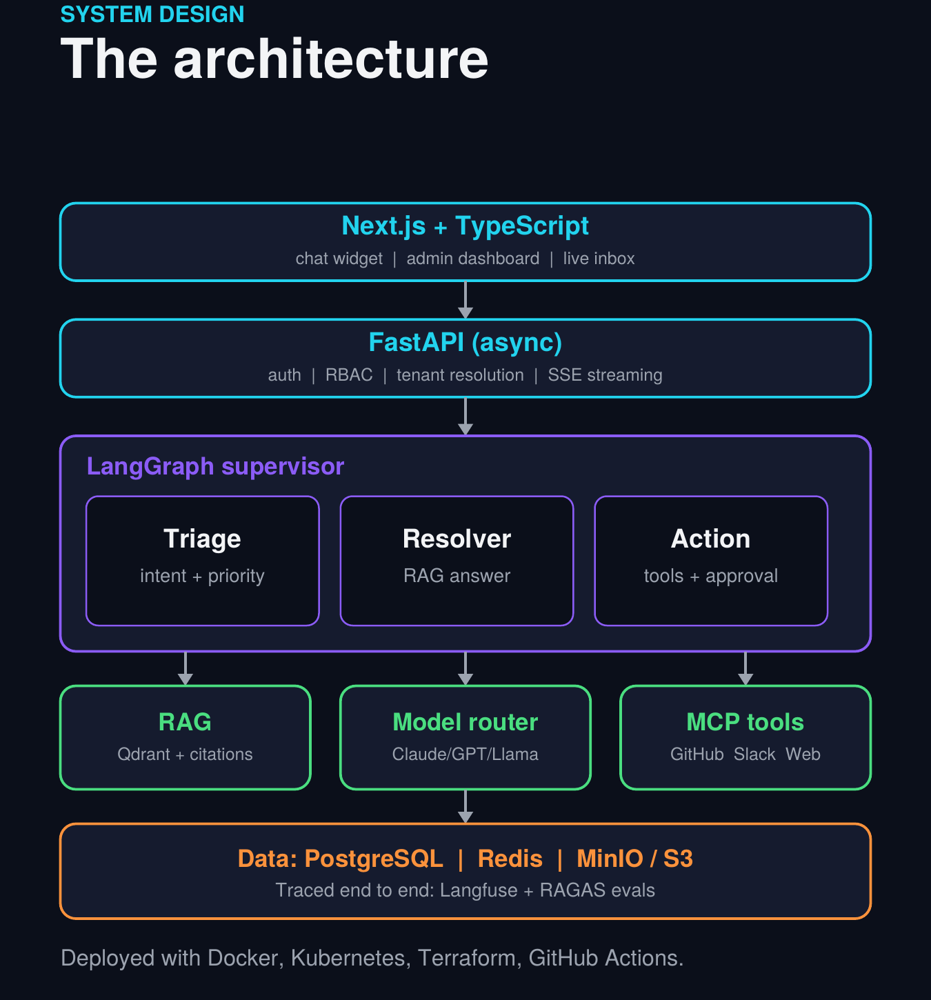

# SupportPilot


**A multi-tenant, agentic AI customer support platform.** Companies upload their docs, AI agents answer customers with citations, take approved actions (GitHub issue, Slack alert) through MCP tools, and escalate to a human when confidence is low.

> **Status: Week 1 of 8 complete.** The foundation (multi-tenant data model, auth, RBAC, tenant-scoped API, migrations, CI) is built and tested. AI features land in Weeks 2-8. I'm building this in public; see the roadmap below.



## Why this project
Most AI support bots only answer questions. Real support needs three more things:

1. **Data isolation:** many companies share one platform; their data must never mix.
2. **Reliable answers:** cite sources, and say "I don't know" (and hand over to a human) instead of guessing.
3. **Action:** a bug report should create a ticket and alert the team, with human approval for risky steps.

## What works today (Week 1)
- Tenant registration: creating a company also creates its owner
- JWT access tokens (15 min) plus refresh tokens with **rotation**, stored hashed in Redis; logout revokes them
- Role-based access control: `owner`, `admin`, `agent`
- Login rate limiting (5 attempts per minute per IP, Redis)
- Tenant-scoped customers and conversations API (other tenants' objects return 404)
- PostgreSQL schema managed with Alembic migrations
- 17 automated tests, including tenant-isolation tests, run in GitHub Actions
- Docker Compose for PostgreSQL, Redis, Qdrant and MinIO

## Tech stack
| Layer | Technology | Status |
|---|---|---|
| API | Python 3.12, FastAPI (async), SQLAlchemy 2, Pydantic | Done |
| Data | PostgreSQL, Redis, Alembic | Done |
| Infra | Docker Compose, GitHub Actions | Done |
| Frontend | Next.js, TypeScript | Week 2 |
| RAG | Qdrant, embeddings, citations | Week 3 |
| Agents | LangGraph (Triage, Resolver, Action), model router (Claude / GPT / Ollama) | Week 4 |
| Tools | Custom MCP server (GitHub, Slack, browser) | Week 5 |
| Storage and workers | MinIO / S3, background jobs | Week 6 |
| Observability | Langfuse, RAGAS evals in CI | Week 7 |
| Deployment | Kubernetes, Terraform | Week 8 |

## Quickstart
Requirements: Docker Desktop, Python 3.12, Git.

```bash
git clone https://github.com/BanothuNithin/supportpilot.git
cd supportpilot
cp .env.example .env            # Windows: copy .env.example .env
# edit .env: set POSTGRES_PASSWORD (letters and numbers), the same password in DATABASE_URL, and JWT_SECRET

docker compose up -d postgres redis qdrant minio

cd backend
python -m venv .venv && source .venv/bin/activate    # Windows: .venv\Scripts\activate
pip install -r requirements.txt
alembic upgrade head
uvicorn app.main:app --reload
```

Open http://localhost:8000/docs for the interactive API.

Run the tests (no Docker needed, they use SQLite and a fake Redis):
```bash
cd backend && pytest -q
```

## API overview
Base path `/api/v1`

| Endpoint | Description | Access |
|---|---|---|
| `POST /auth/register` | Create tenant and owner | Public |
| `POST /auth/login` | Get access and refresh tokens (rate limited) | Public |
| `POST /auth/refresh` | Rotate refresh token, get a new pair | Public |
| `POST /auth/logout` | Revoke a refresh token | Public |
| `GET /auth/me` | Current user | Authenticated |
| `POST/GET /auth/users` | Add or list staff of your tenant | Owner, Admin |
| `POST/GET/PATCH/DELETE /customers` | Tenant-scoped customers (delete: owner, admin) | Authenticated |
| `POST/GET /conversations`, `GET /conversations/{id}` | Tenant-scoped conversations with messages | Authenticated |

<!-- Add your own screenshot: Swagger showing the 403 for an agent calling POST /auth/users -->
<!--  -->

## Roadmap
| Week | Focus |
|---|---|
| 1 | Schema, auth, RBAC, tenants, migrations, CI (done) |
| 2 | Next.js chat UI, SSE streaming |
| 3 | RAG ingestion, Qdrant, citations |
| 4 | LangGraph agents, memory, model router |
| 5 | MCP tools, human approval, escalation |
| 6 | Redis workers, S3, Postgres Row-Level Security |
| 7 | Langfuse, RAGAS evals in CI, load tests |
| 8 | Kubernetes, Terraform, live deployment |

## Docs
- [Architecture and data model](docs/ARCHITECTURE.md)
- [Design decisions and trade-offs](DECISIONS.md)

## Author
Banothu Nithin, Full Stack and Applied AI Engineer, Hyderabad.
