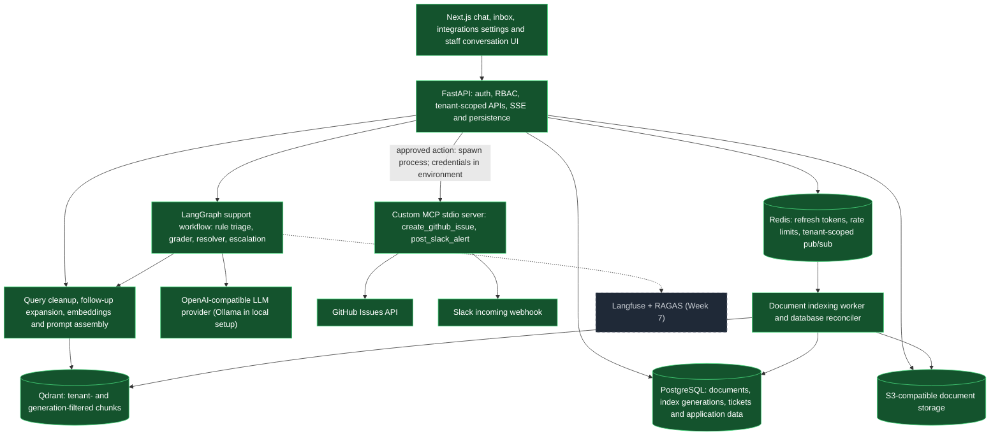
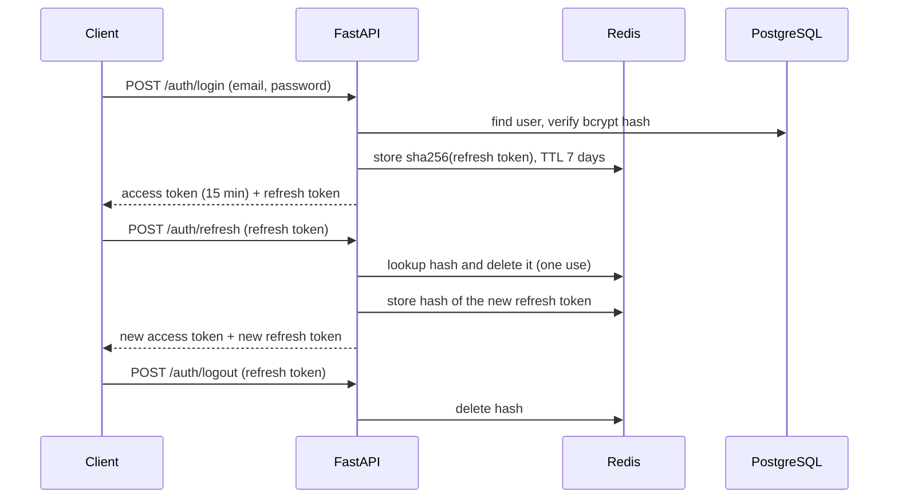
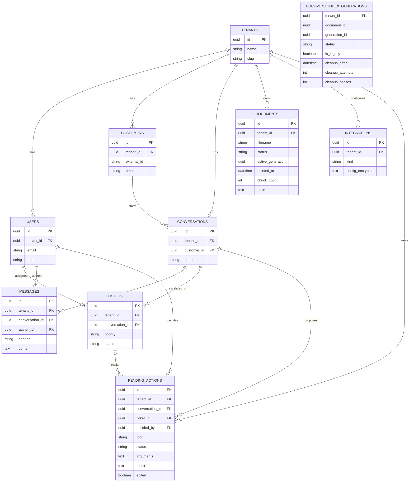

# Architecture (Week 6)

Solid boxes are built. Dashed boxes are planned (week in brackets).



## Support-agent flow (built)
1. FastAPI verifies the token, resolves the tenant, saves the customer message, and loads recent conversation history. Exact stored handoff responses are excluded before the latest six messages are passed to the graph.
2. The triage node uses deterministic rules, not an LLM. A detected human request goes directly to escalation; greetings and supported assistant-meta questions go directly to resolution without retrieval.
3. Other support messages are cleaned for search. Genuine follow-ups are expanded with the most recent prior user question; the original message and conversation wording remain the input to answer generation.
4. Retrieval loads the tenant's active document generations from PostgreSQL, then searches Qdrant with tenant and document/generation filters plus the configured score threshold. Documents without a published generation can still use legacy generation-less vectors.
5. If there are hits, the grader makes a short JSON completion to judge whether the context answers the query. If there are no hits, grading is skipped and the question is not considered grounded.
6. The decide node routes a grounded answer to resolution; no-reliable-answer, low-confidence, and customer-requested-human outcomes go to escalation.
7. Grounded resolution emits citations and streams an answer. Escalation streams the configured handoff text and persists a support ticket; it does not itself contact or notify a human.
8. The API streams step, triage, decision, citations, token, escalation, and completion events. The decision event includes search diagnostics; server logs omit the customer question and search query. The final event includes time to first token and per-node timings.

The grader is the only LLM completion before answer generation. Fast paths make no grader call; the resolver still uses the configured model provider to generate responses.

## Bug-report proposals and approval (built)

Bug detection is rule-based. A bug report creates a ticket and a truthful handoff reply. For each configured integration, the application creates a pending action; the AI does not execute external side effects. GitHub issue text includes customer-reported text in a dynamically sized code fence labeled `UNTRUSTED`. Tool arguments are Pydantic-validated and sanitized by the allow-listed registry.

```mermaid
sequenceDiagram
    participant C as Chat UI (customer simulated in staff chat)
    participant A as FastAPI chat API
    participant G as Rule-based agent
    participant D as PostgreSQL
    participant S as Staff conversation UI
    participant O as Owner or Admin
    participant E as Actions API
    participant M as MCP stdio subprocess
    participant GH as GitHub Issues API
    participant SL as Slack incoming webhook

    C->>A: POST /api/v1/conversations/{id}/messages (bug report)
    A->>D: Save customer message
    A->>G: Triage using deterministic rules
    G-->>A: Escalate with reason bug_report
    A->>D: One transaction: save handoff, ticket, and configured pending actions
    A-->>C: Stream truthful ticket-created reply
    S->>E: GET /api/v1/actions?conversation_id={id}
    E->>D: List actions filtered by tenant and conversation
    D-->>E: Pending proposals
    E-->>S: Proposal arguments and status
    O->>E: POST /api/v1/actions/{id}/approve (optional edited arguments)
    E->>D: Atomic compare-and-set pending/failed to approved
    E->>D: Read tenant-scoped encrypted integration
    E->>E: Decrypt integration configuration
    alt GitHub issue action
        E->>M: Start MCP process; pass GitHub credentials in environment
        Note over E,M: Tool arguments contain issue text and labels, never credentials
        M->>GH: POST issue with validated, sanitized arguments
        GH-->>M: Issue number and URL
    else Slack alert action
        E->>M: Start MCP process; pass webhook URL in environment
        M->>SL: POST alert with validated, escaped text
        SL-->>M: Success or HTTP error
    end
    M-->>E: Tool result or redacted error
    E->>D: Save executed or failed status and result
    E-->>S: Return updated action
    opt Failed action retry
        O->>E: Approve failed action again
    end
```

The official Python MCP SDK is pinned at `mcp~=1.30.0`. One subprocess is started per approved action. The GitHub and Slack operations are separate proposals and are approved independently. The approval endpoint uses a database compare-and-set so concurrent approvals do not execute the same action twice.

## Staff replies and live conversation updates (built)

```mermaid
sequenceDiagram
    participant S as Staff conversation UI
    participant A as FastAPI conversations API
    participant D as PostgreSQL
    participant R as Redis pub/sub
    participant C as Chat UI (customer simulated in staff chat)

    S->>A: POST /api/v1/conversations/{id}/human-reply
    A->>D: Verify tenant and escalated status
    A->>D: Save human message and update open ticket
    A->>R: Publish message to conv:{tenant_id}:{conversation_id}
    A-->>S: Return saved message
    C->>A: GET /api/v1/conversations/{id}/events
    A->>D: Verify conversation belongs to tenant before subscribing
    A->>R: Subscribe to tenant-scoped channel
    R-->>A: Published message event
    A-->>C: SSE event: message
    A-->>C: SSE heartbeat while idle
    Note over C,A: On reconnect, refetch persisted messages; pub/sub does not replay
```

Publishing is best-effort and happens after the database commit. SSE subscribers receive heartbeats; the client reconnects with backoff and refetches persisted messages after reconnecting. Redis pub/sub is not a durable event log.

## Document ingestion (built)
```mermaid
sequenceDiagram
    participant U as Owner or Admin
    participant A as FastAPI
    participant D as PostgreSQL
    participant R as Redis queue
    participant W as Indexing worker
    participant RC as Reconciler
    participant X as Extractor
    participant C as Chunker
    participant E as Embedder
    participant Q as Qdrant
    U->>A: POST /api/v1/documents (file)
    A->>D: Create document with status queued
    A->>R: Best-effort enqueue hint
    A-->>U: 202 Accepted
    W->>D: Atomic queued-to-indexing claim with fresh UUID token and lease
    W->>X: Load stored bytes and extract text
    X-->>W: Text
    W->>C: Split paragraphs (800 chars, 100 overlap)
    C-->>W: Chunks
    W->>E: Embed chunks; renew lease while processing
    E-->>W: Vectors
    W->>Q: Upsert deterministic points for claim-token generation
    Q-->>W: Write acknowledged
    alt Indexing succeeds
        W->>D: Publish active_generation only if token and lease still match
        Note over D,Q: Previous generation stays searchable until publication commits
    else Indexing fails
        W->>D: Set retry/failed only if token and lease still match; retain active_generation
    end
    RC->>D: Find queued work and expired leases
    RC->>D: Requeue/fail expired claims; mark abandoned generations
    RC->>R: Best-effort enqueue recovered work
    RC->>Q: Retry tenant/document/generation-specific cleanup
    U->>A: DELETE /api/v1/documents/{id}
    A->>D: Tombstone document and clear active_generation
    A->>Q: Best-effort cleanup; retries remain in PostgreSQL
    A->>S3: Best-effort object cleanup; retries remain in PostgreSQL
```

Each claim UUID is also its isolated Qdrant generation ID. Generation-specific point IDs prevent concurrent attempts from overwriting one another. Retrieval trusts only the generation pointer committed in PostgreSQL; staging, retired, abandoned, and late-arriving points are invisible. Retired and abandoned generation records are retained and swept repeatedly so a delayed Qdrant write can be removed by a later cleanup pass. Deleted documents remain tombstoned until initial vector and object cleanup succeeds; their generation ledger remains for later cleanup passes.

## Answering a question (built)
```mermaid
sequenceDiagram
    participant U as Chat UI
    participant A as FastAPI
    participant D as PostgreSQL
    participant G as LangGraph
    participant E as Embedder
    participant Q as Qdrant
    participant L as LLM provider
    U->>A: POST /api/v1/conversations/{id}/messages
    A->>D: Save customer message; load and filter recent history
    A->>G: Start graph with original message, history and tenant_id
    G->>G: Rule-based triage
    alt Explicit human request
        G-->>A: Escalation decision and handoff token
        A->>D: Save handoff and create ticket
        A-->>U: SSE decision, token, escalated, done
    else Greeting or assistant-meta question
        G-->>A: Chitchat decision and no-context answer tokens
        A->>D: Save assistant reply
        A-->>U: SSE decision, tokens, done
    else Normal support question
        G->>G: Clean query and expand genuine follow-up from prior user question
        G->>E: Embed search query
        E-->>G: Query vector
        G->>Q: Search with mandatory tenant_id filter (top_k 4, configured minimum score; default 0.35)
        Q-->>G: Matching chunks, if any
        alt Hits found
            G->>L: Grade answerability (JSON, max_tokens 80)
            L-->>G: can_answer and confidence
        else No hits
            G->>G: Skip grader call; mark not answerable
        end
        G->>G: Decide answer or escalation
        alt Grounded and confident
            G-->>A: Decision, citations, streamed answer tokens
            A-->>U: SSE decision, citations, tokens
            A->>D: Save assistant reply and citations
        else No reliable answer or low confidence
            G-->>A: Escalation decision and handoff token
            A->>D: Save handoff and create ticket
            A-->>U: SSE decision, token, escalated, done
        end
        A-->>U: SSE done with TTFT and stage timings
    end
```

## Auth flow (built)


## Data model
Every business table carries `tenant_id`.



## Tenant isolation rules
1. The tenant comes from the verified JWT, never from the request body.
2. Every query filters by `tenant_id`, through the shared `get_owned` helper for lookups by id.
3. Another tenant's object returns 404, not 403, so ids cannot be probed.
4. Vector searches (Week 3) always carry a tenant filter.
5. Week 6 adds PostgreSQL Row-Level Security as a second line of defense..
