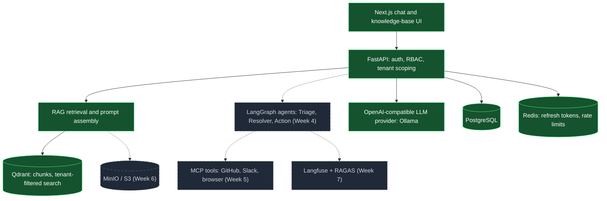
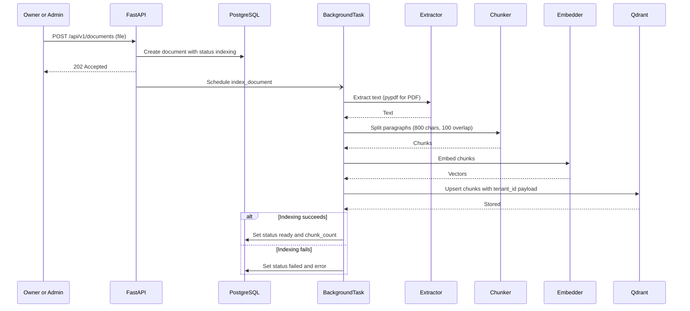
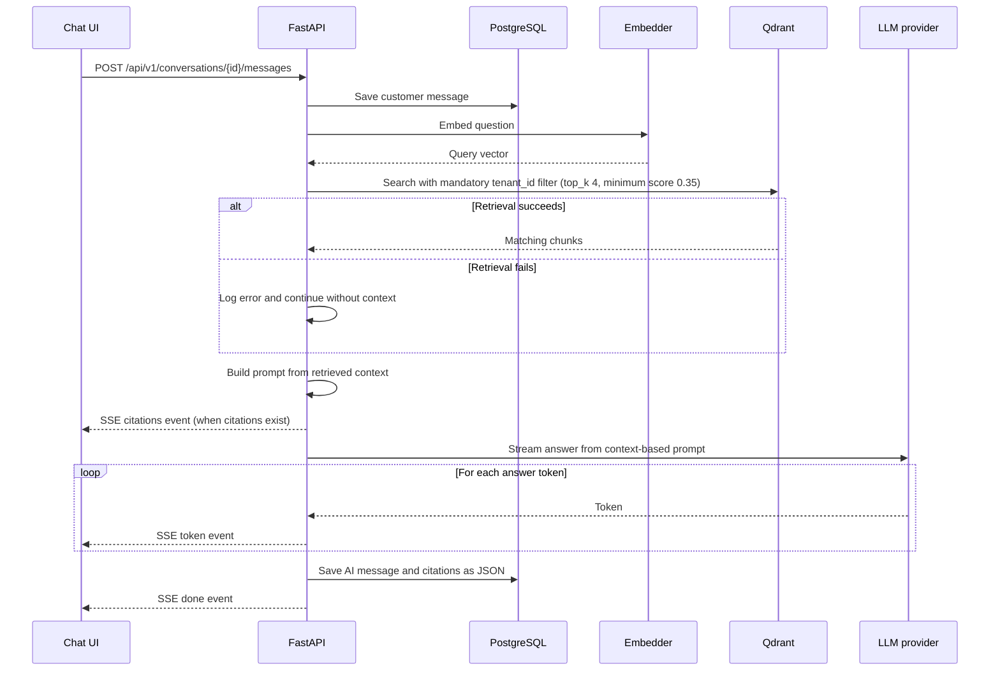
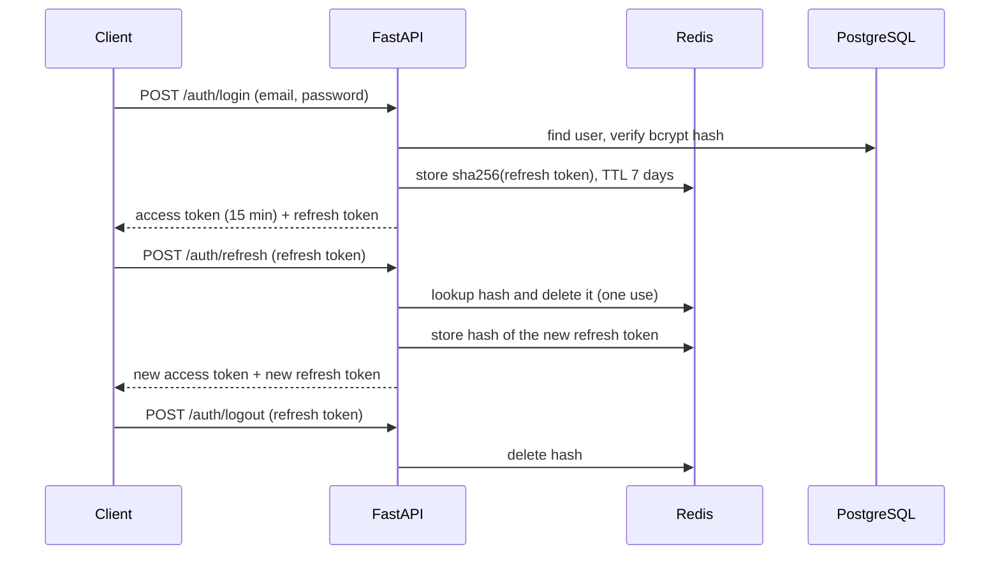
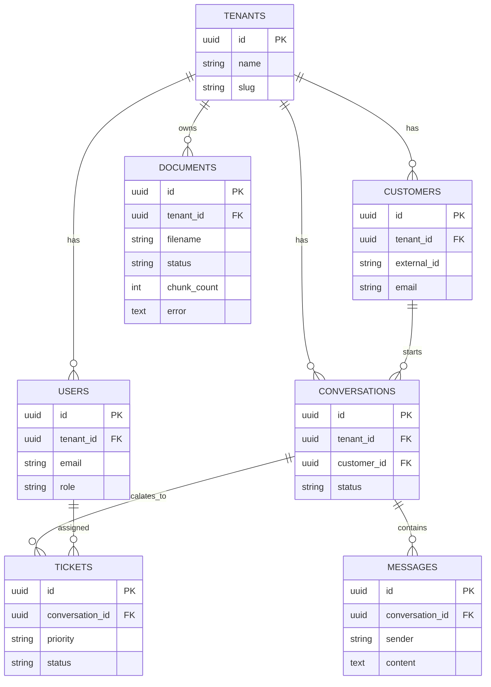

# Architecture

Solid boxes are built. Dashed boxes are planned (week in brackets).

## Request flow (target design)
1. The customer sends a message from the chat widget.
2. FastAPI verifies the token, resolves the tenant and checks rate limits.
3. The Triage agent classifies intent and priority.
4. The Resolver agent retrieves tenant-filtered chunks from Qdrant and answers with citations, streamed over SSE.
5. The Action agent calls MCP tools. Sensitive actions wait for human approval.
6. Low confidence escalates the conversation to a human agent.
7. Every step is traced for quality, latency and cost.

## Document ingestion (built)

## Answering a question (built)

## Auth flow (built)

## Data model
Every business table carries `tenant_id`.

## Tenant isolation rules
1. The tenant comes from the verified JWT, never from the request body.
2. Every query filters by `tenant_id`, through the shared `get_owned` helper for lookups by id.
3. Another tenant's object returns 404, not 403, so ids cannot be probed.
4. Vector searches (Week 3) always carry a tenant filter.
5. Week 6 adds PostgreSQL Row-Level Security as a second line of defense.
