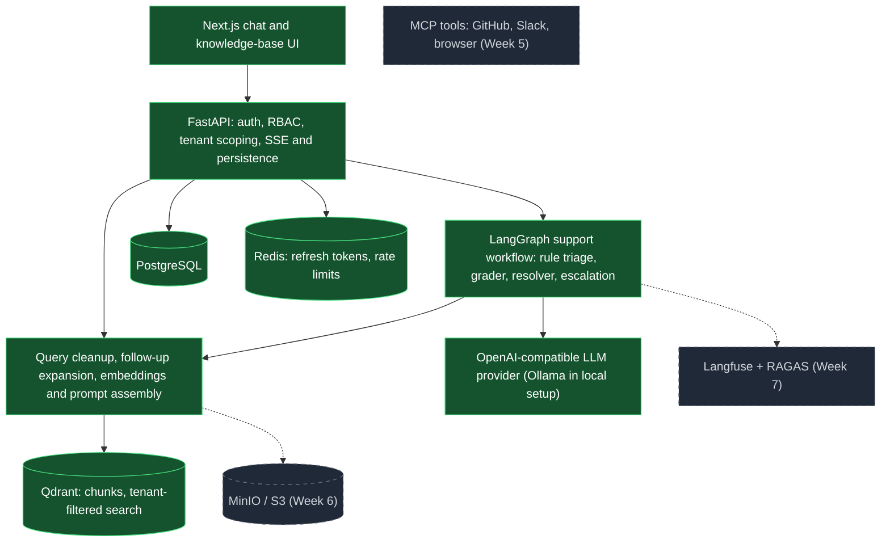
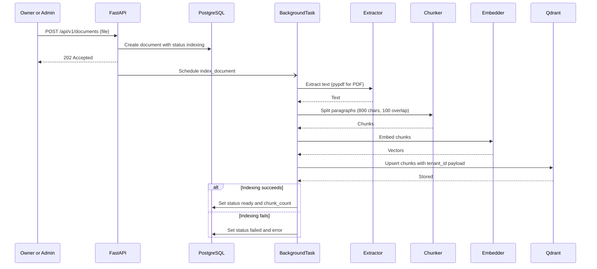
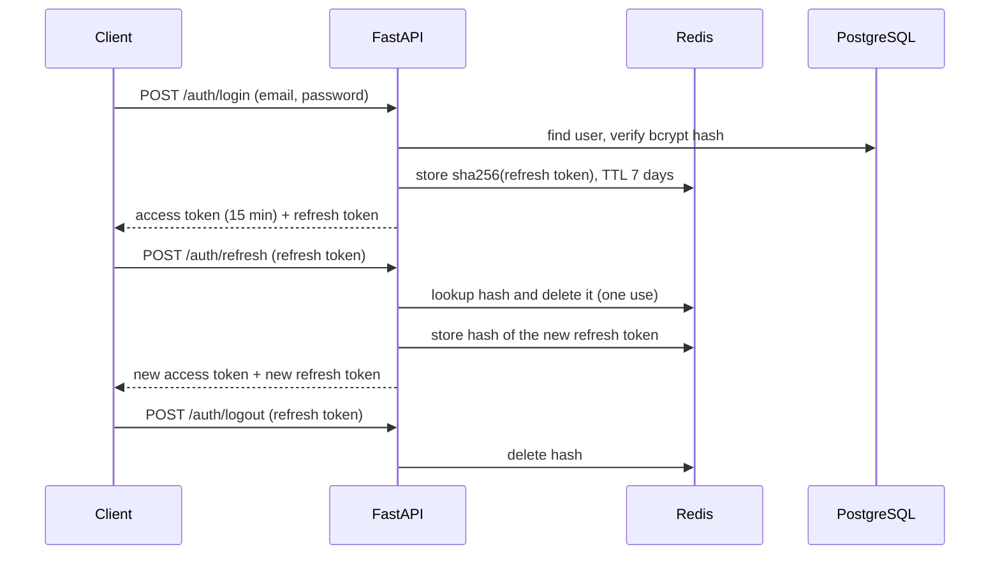
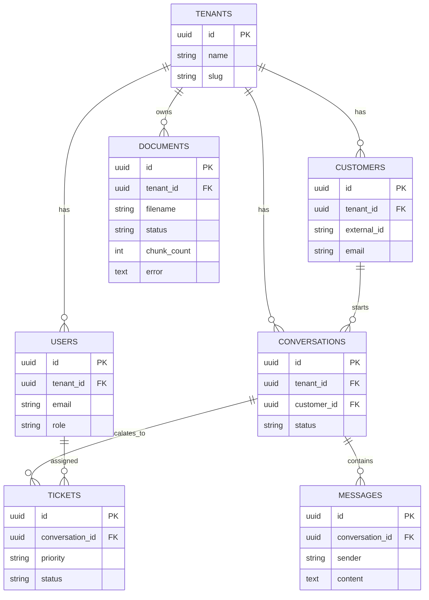

# Architecture (Week 4)

Solid boxes are built. Dashed boxes are planned (week in brackets).



## Support-agent flow (built)
1. FastAPI verifies the token, resolves the tenant, saves the customer message, and loads recent conversation history. Exact stored handoff responses are excluded before the latest six messages are passed to the graph.
2. The triage node uses deterministic rules, not an LLM. A detected human request goes directly to escalation; greetings and supported assistant-meta questions go directly to resolution without retrieval.
3. Other support messages are cleaned for search. Genuine follow-ups are expanded with the most recent prior user question; the original message and conversation wording remain the input to answer generation.
4. Retrieval embeds the search query and searches Qdrant with the mandatory tenant filter and configured score threshold.
5. If there are hits, the grader makes a short JSON completion to judge whether the context answers the query. If there are no hits, grading is skipped and the question is not considered grounded.
6. The decide node routes a grounded answer to resolution; no-reliable-answer, low-confidence, and customer-requested-human outcomes go to escalation.
7. Grounded resolution emits citations and streams an answer. Escalation streams the configured handoff text and persists a support ticket; it does not itself contact or notify a human.
8. The API streams step, triage, decision, citations, token, escalation, and completion events. The decision event includes search diagnostics; server logs omit the customer question and search query. The final event includes time to first token and per-node timings.

The grader is the only LLM completion before answer generation. Fast paths make no grader call; the resolver still uses the configured model provider to generate responses.

## Document ingestion (built)


## Answering a question (built)
```mermaid
sequenceDiagram
    participant U as Chat UI
    participant A as FastAPI
    participant D as PostgreSQL
    participant G as LangGraph
    participant E as Embedder
    participant Q as Qdrant
    participant L as LLM provider
    U->>A: POST /api/v1/conversations/{id}/messages
    A->>D: Save customer message; load and filter recent history
    A->>G: Start graph with original message, history and tenant_id
    G->>G: Rule-based triage
    alt Explicit human request
        G-->>A: Escalation decision and handoff token
        A->>D: Save handoff and create ticket
        A-->>U: SSE decision, token, escalated, done
    else Greeting or assistant-meta question
        G-->>A: Chitchat decision and no-context answer tokens
        A->>D: Save assistant reply
        A-->>U: SSE decision, tokens, done
    else Normal support question
        G->>G: Clean query and expand genuine follow-up from prior user question
        G->>E: Embed search query
        E-->>G: Query vector
        G->>Q: Search with mandatory tenant_id filter (top_k 4, configured minimum score; default 0.35)
        Q-->>G: Matching chunks, if any
        alt Hits found
            G->>L: Grade answerability (JSON, max_tokens 80)
            L-->>G: can_answer and confidence
        else No hits
            G->>G: Skip grader call; mark not answerable
        end
        G->>G: Decide answer or escalation
        alt Grounded and confident
            G-->>A: Decision, citations, streamed answer tokens
            A-->>U: SSE decision, citations, tokens
            A->>D: Save assistant reply and citations
        else No reliable answer or low confidence
            G-->>A: Escalation decision and handoff token
            A->>D: Save handoff and create ticket
            A-->>U: SSE decision, token, escalated, done
        end
        A-->>U: SSE done with TTFT and stage timings
    end
```

## Auth flow (built)


## Data model
Every business table carries `tenant_id`.



## Tenant isolation rules
1. The tenant comes from the verified JWT, never from the request body.
2. Every query filters by `tenant_id`, through the shared `get_owned` helper for lookups by id.
3. Another tenant's object returns 404, not 403, so ids cannot be probed.
4. Vector searches (Week 3) always carry a tenant filter.
5. Week 6 adds PostgreSQL Row-Level Security as a second line of defense.
