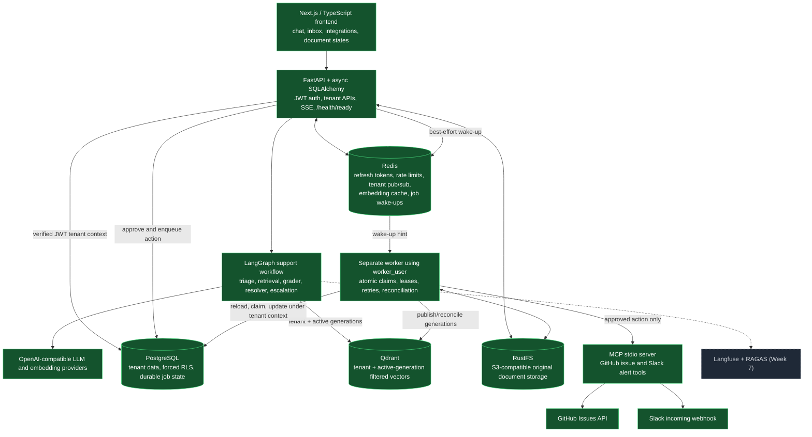
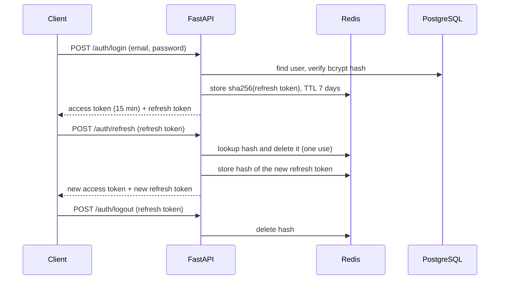
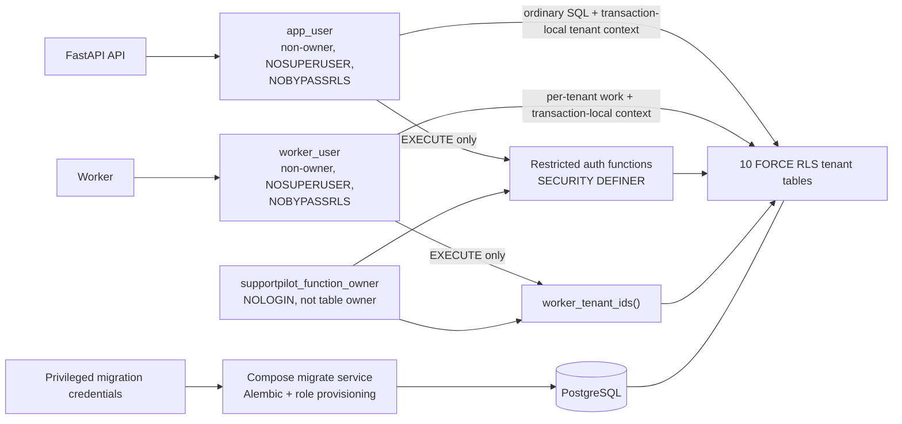

# Architecture (Week 6)

Solid boxes are implemented. Dashed boxes are planned.



## Components and security boundaries

- **Frontend:** Next.js/TypeScript chat, staff inbox and integration settings; document status polling, reindexing and downloads; visible chat rate-limit feedback.
- **API:** FastAPI request handling and async SQLAlchemy persistence. The LangGraph workflow performs deterministic triage, tenant-filtered retrieval, answerability grading, grounded resolution, or ticket escalation. `/health/ready` checks PostgreSQL, Redis, Qdrant, object storage, and runtime-role safety.
- **PostgreSQL:** source of truth for tenant data, document generations, action status, and durable job state. Atomic compare-and-set claims, leases, bounded retries, and the reconciler recover eligible work.
- **Redis:** refresh-token storage, fixed-window rate-limit counters, tenant-scoped conversation pub/sub, tenant-keyed query-embedding cache, and queue wake-up notifications. Redis queue messages are hints; workers reload authoritative rows from PostgreSQL.
- **Worker:** a separate process using `worker_user`. It enumerates tenant IDs through a restricted function, then handles jobs with each tenant's transaction context. It indexes documents and executes approved actions.
- **Retrieval and storage:** Qdrant searches by tenant and published active generation; PostgreSQL revalidates hits. RustFS provides the local S3-compatible service for original documents.
- **External actions:** only the worker starts the custom MCP stdio server for approved GitHub/Slack actions. Credentials are supplied through the subprocess environment and are not tool arguments.

Chat rate limiting uses tenant and user fixed-window counters and fails open if Redis is unavailable; login rate limiting uses the default fail-closed behavior. Query-embedding cache keys include the tenant ID and a query/model digest. Redis pub/sub is best-effort and does not replay missed conversation events.

## Support-agent flow (built)
1. FastAPI verifies the JWT, takes the tenant ID from its signed claims, and establishes the transaction-local PostgreSQL context before loading the user or conversation. It then saves the customer message and loads recent history. Exact stored handoff responses are excluded before the latest six messages are passed to the graph.
2. The triage node uses deterministic rules, not an LLM. A detected human request goes directly to escalation; greetings and supported assistant-meta questions go directly to resolution without retrieval.
3. Other support messages are cleaned for search. Genuine follow-ups are expanded with the most recent prior user question; the original message and conversation wording remain the input to answer generation.
4. Retrieval loads the tenant's active document generations from PostgreSQL, then searches Qdrant with tenant and document/generation filters plus the configured score threshold. Before returning hits to grading or citation generation, it revalidates each hit's document and generation against PostgreSQL. Documents without a published generation can still use legacy generation-less vectors.
5. If there are hits, the grader makes a short JSON completion to judge whether the context answers the query. If there are no hits, grading is skipped and the question is not considered grounded.
6. The decide node routes a grounded answer to resolution; no-reliable-answer, low-confidence, and customer-requested-human outcomes go to escalation.
7. Grounded resolution emits citations and streams an answer. Escalation streams the configured handoff text and persists a support ticket; it does not itself contact or notify a human.
8. The API streams step, triage, decision, citations, token, escalation, and completion events. The decision event includes search diagnostics; server logs omit the customer question and search query. The final event includes time to first token and per-node timings.

The grader is the only LLM completion before answer generation. Fast paths make no grader call; the resolver still uses the configured model provider to generate responses.

## Approved-action lifecycle (built)

Bug detection is rule-based. A bug report creates a ticket and a truthful handoff reply. For each configured integration, the application creates a pending proposal; the AI does not execute external side effects. GitHub issue text includes customer-reported text in a dynamically sized code fence labeled `UNTRUSTED`. Tool arguments are Pydantic-validated and sanitized by the allow-listed registry.

```mermaid
sequenceDiagram
    participant C as Chat UI (customer simulated in staff chat)
    participant A as FastAPI chat API
    participant G as Rule-based agent
    participant D as PostgreSQL (durable state)
    participant S as Staff conversation UI
    participant O as Owner or Admin
    participant E as Actions API
    participant R as Redis queue (wake-up hints)
    participant W as Worker (worker_user)
    participant RC as Reconciler
    participant M as MCP stdio subprocess
    participant GH as GitHub Issues API
    participant SL as Slack incoming webhook

    C->>A: POST /api/v1/conversations/{id}/messages (bug report)
    A->>D: Save customer message
    A->>G: Triage using deterministic rules
    G-->>A: Escalate with reason bug_report
    A->>D: One transaction: save handoff, ticket, and configured pending actions
    A-->>C: Stream truthful ticket-created reply
    S->>E: GET /api/v1/actions?conversation_id={id}
    E->>D: List actions filtered by tenant and conversation
    D-->>E: Pending proposals
    E-->>S: Proposal arguments and status
    O->>E: POST /api/v1/actions/{id}/approve (optional edited arguments)
    E->>D: Atomic compare-and-set pending/failed to approved
    E->>R: Enqueue execute_action hint
    E-->>S: Return approved action
    R-->>W: Deliver wake-up hint
    W->>D: Reload action and atomically claim approved to executing with lease
    W->>D: Read tenant-scoped encrypted integration under tenant context
    W->>W: Decrypt integration configuration
    alt GitHub issue action
        W->>M: Start MCP process; pass GitHub credentials in environment
        Note over W,M: Tool arguments contain issue text and labels, never credentials
        M->>GH: POST issue with validated, sanitized arguments
        GH-->>M: Issue number and URL
    else Slack alert action
        W->>M: Start MCP process; pass webhook URL in environment
        M->>SL: POST alert with validated, escaped text
        SL-->>M: Success or HTTP error
    end
    M-->>W: Tool result or redacted error
    W->>D: Save executed or failed status and result
    RC->>D: Per-tenant scan of stale approved and expired executing actions
    RC->>R: Requeue stale approved actions if wake-up was lost
    RC->>D: Mark expired executing action failed with outcome-unknown message
    Note over RC,D: An uncertain external outcome is not automatically retried
    opt Human-reviewed retry
        O->>E: Approve failed action again after checking target system
    end
```

The official Python MCP SDK is pinned at `mcp~=1.30.0`. One subprocess is started per approved action. The GitHub and Slack operations are separate proposals and are approved independently. The API compare-and-set permits one approval transition; the worker's atomic `approved`-to-`executing` claim prevents duplicate queue deliveries from starting multiple executions. If execution may have reached the external system but the result is unknown, the reconciler marks the action failed and does not retry it automatically. A human can check the target system before deciding whether to approve another attempt.

## Staff replies and live conversation updates (built)

```mermaid
sequenceDiagram
    participant S as Staff conversation UI
    participant A as FastAPI conversations API
    participant D as PostgreSQL
    participant R as Redis pub/sub
    participant C as Chat UI (customer simulated in staff chat)

    S->>A: POST /api/v1/conversations/{id}/human-reply
    A->>D: Verify tenant and escalated status
    A->>D: Save human message and update open ticket
    A->>R: Publish message to conv:{tenant_id}:{conversation_id}
    A-->>S: Return saved message
    C->>A: GET /api/v1/conversations/{id}/events
    A->>D: Verify conversation belongs to tenant before subscribing
    A->>R: Subscribe to tenant-scoped channel
    R-->>A: Published message event
    A-->>C: SSE event: message
    A-->>C: SSE heartbeat while idle
    Note over C,A: On reconnect, refetch persisted messages; pub/sub does not replay
```

Publishing is best-effort and happens after the database commit. SSE subscribers receive heartbeats; the client reconnects with backoff and refetches persisted messages after reconnecting. Redis pub/sub is not a durable event log.

## Document ingestion (built)
```mermaid
sequenceDiagram
    participant U as Owner or Admin
    participant A as FastAPI
    participant D as PostgreSQL
    participant R as Redis queue
    participant W as Indexing worker
    participant RC as Reconciler
    participant S3 as RustFS S3-compatible storage
    participant X as Extractor
    participant C as Chunker
    participant E as Embedder
    participant Q as Qdrant
    U->>A: POST /api/v1/documents (file)
    A->>S3: Store original under generated tenant/document key
    A->>D: Create document with status queued
    A->>R: Best-effort enqueue hint
    A-->>U: 202 Accepted
    R-->>W: Wake-up hint (may be lost)
    W->>D: Reload document; atomic queued-to-indexing claim with UUID token and lease
    W->>S3: Load stored bytes
    W->>X: Extract text
    X-->>W: Text
    W->>C: Split paragraphs (800 chars, 100 overlap)
    C-->>W: Chunks
    W->>E: Embed chunks; renew lease while processing
    E-->>W: Vectors
    W->>Q: Upsert deterministic points for claim-token generation
    Q-->>W: Write acknowledged
    alt Indexing succeeds
        W->>D: Publish active_generation only if token and lease still match
        Note over D,Q: Previous generation stays searchable until publication commits
    else Indexing fails
        W->>D: Set retry/failed only if token and lease still match; retain active_generation
    end
    RC->>D: Enumerate tenant IDs and scan each tenant context for queued work and expired leases
    RC->>D: Requeue/fail expired claims; mark abandoned generations
    RC->>R: Best-effort enqueue recovered work
    RC->>Q: Retry tenant/document/generation-specific cleanup
    U->>A: DELETE /api/v1/documents/{id}
    A->>D: Tombstone document and clear active_generation
    A->>Q: Best-effort cleanup; retries remain in PostgreSQL
    A->>S3: Best-effort object cleanup; retries remain in PostgreSQL
```

Each claim UUID is also its isolated Qdrant generation ID. Generation-specific point IDs prevent concurrent attempts from overwriting one another. Retrieval trusts only the generation pointer committed in PostgreSQL; staging, retired, abandoned, and late-arriving points are invisible. Retired and abandoned generation records are retained and swept repeatedly so a delayed Qdrant write can be removed by a later cleanup pass. Deleted documents remain tombstoned until vector and object cleanup succeeds; a per-document cleanup_after timestamp schedules retries in bounded batches, while generation ledger records remain for later cleanup passes.

## Answering a question (built)
```mermaid
sequenceDiagram
    participant U as Chat UI
    participant A as FastAPI
    participant D as PostgreSQL
    participant G as LangGraph
    participant E as Embedder
    participant Q as Qdrant
    participant L as LLM provider
    U->>A: POST /api/v1/conversations/{id}/messages
    A->>D: Save customer message; load and filter recent history
    A->>G: Start graph with original message, history and tenant_id
    G->>G: Rule-based triage
    alt Explicit human request
        G-->>A: Escalation decision and handoff token
        A->>D: Save handoff and create ticket
        A-->>U: SSE decision, token, escalated, done
    else Greeting or assistant-meta question
        G-->>A: Chitchat decision and no-context answer tokens
        A->>D: Save assistant reply
        A-->>U: SSE decision, tokens, done
    else Normal support question
        G->>G: Clean query and expand genuine follow-up from prior user question
        G->>E: Embed search query
        E-->>G: Query vector
        G->>Q: Search with mandatory tenant_id filter (top_k 4, configured minimum score; default 0.35)
        Q-->>G: Matching chunks, if any
        alt Hits found
            G->>L: Grade answerability (JSON, max_tokens 80)
            L-->>G: can_answer and confidence
        else No hits
            G->>G: Skip grader call; mark not answerable
        end
        G->>G: Decide answer or escalation
        alt Grounded and confident
            G-->>A: Decision, citations, streamed answer tokens
            A-->>U: SSE decision, citations, tokens
            A->>D: Save assistant reply and citations
        else No reliable answer or low confidence
            G-->>A: Escalation decision and handoff token
            A->>D: Save handoff and create ticket
            A-->>U: SSE decision, token, escalated, done
        end
        A-->>U: SSE done with TTFT and stage timings
    end
```

## Auth flow (built)


## Data model
Every tenant-owned business row carries `tenant_id`; the `tenants` table is scoped by its `id`.


## PostgreSQL tenant isolation and database roles

The verified JWT is the source of request tenant identity, never a request body, path, or header. Ordinary API queries remain tenant-scoped through explicit filters and `get_owned`; unscoped API lookups are limited to restricted authentication functions needed before a tenant is known. Another tenant's object returns 404. Vector searches include tenant and active-generation filters, and hits are revalidated against PostgreSQL.

The SQLAlchemy `after_begin` hook calls `set_config('app.tenant_id', ..., true)` for each PostgreSQL transaction, using the tenant saved on the session. Transaction-local scope avoids carrying a tenant into a later transaction on a pooled connection. RLS is both enabled and forced for `users`, `customers`, `conversations`, `messages`, `tickets`, `documents`, `integrations`, `pending_actions`, `document_index_generations`, and `tenants`. Policies compare each row's `tenant_id` (or `tenants.id`) with this context; setting `app.system` does not bypass them.



`supportpilot_function_owner` owns the fixed-search-path `SECURITY DEFINER` functions, not the tenant tables. It is `NOLOGIN` and has `BYPASSRLS` for those narrow function operations. Authentication functions (`auth_email_exists`, `auth_user_for_login`, `auth_user_for_refresh`, and `create_tenant_owner`) are executable by `app_user`; `worker_tenant_ids()` is executable only by `worker_user`. The API role cannot enumerate tenants through the worker function. The worker enumerates tenant IDs, then performs scans and work under each tenant's RLS context.

Migration `c54e2f1d0a6b` enables and forces RLS. Migration `71a08f2c9d4e` removes the system-GUC policy bypass and installs the restricted runtime roles and functions. The dedicated `migrate` Compose service uses privileged `MIGRATION_DATABASE_URL`; neither API nor worker receives migration credentials. The app and worker use `DATABASE_URL` and `WORKER_DATABASE_URL`, respectively.

**Limitation:** the custom `app.tenant_id` GUC is set by the application role. This is defence-in-depth against an accidentally omitted tenant filter, not protection against arbitrary SQL execution under a compromised application role. It does not make SQL injection harmless.
